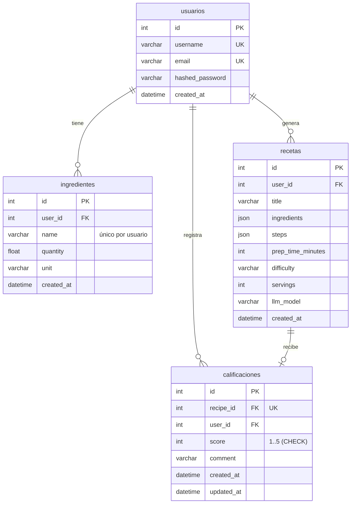

# Recetas IA — Generador de recetas con inventario e IA

Aplicación web en **FastAPI + MySQL** donde cada usuario registra los ingredientes que tiene
en casa y obtiene recetas generadas por un **LLM (OpenRouter)**. Las recetas se guardan en la
base de datos y el usuario puede verlas, calificarlas (1–5 ★) y eliminarlas.

> Proyecto final · Tecnologías Web (5916) · Universidad Simón Bolívar · 2026-2

- **Aplicación desplegada:** https://74-50-85-180.sslip.io
- **Documentación de la API (Swagger):** https://74-50-85-180.sslip.io/docs

## Funcionalidades

| # | Funcionalidad | Endpoint(s) |
|---|---|---|
| 1 | Registro e inicio de sesión (JWT) | `POST /api/auth/register`, `POST /api/auth/login`, `GET /api/auth/me` |
| 2 | CRUD de ingredientes del inventario | `GET/POST /api/ingredients`, `GET/PATCH/DELETE /api/ingredients/{id}` |
| 3 | Generar receta a partir del inventario | `POST /api/recipes/generate` |
| 4 | Ver recetas generadas (historial, filtros) | `GET /api/recipes?difficulty=&min_rating=`, `GET /api/recipes/{id}` |
| 5 | Calificar una receta (1 a 5 estrellas) | `PUT /api/recipes/{id}/rating` |
| 6 | Eliminar recetas del historial | `DELETE /api/recipes/{id}` |

Además: `GET /health` (estado), `GET /docs` (Swagger) y una interfaz web en `/` (HTML + Jinja2 + JS).

## Tecnologías

- **Backend:** Python 3.13, FastAPI, SQLAlchemy 2, Pydantic 2
- **Base de datos:** MySQL 8.4 (SQLite para desarrollo/pruebas)
- **Autenticación:** JWT (PyJWT) + contraseñas con bcrypt
- **LLM:** OpenRouter (API compatible con OpenAI) vía `httpx`
- **Pruebas:** pytest (65 pruebas, incluidas 16 de seguridad y 8 de selección de modelo)
- **Despliegue:** Docker, Docker Compose, Caddy (HTTPS automático con Let's Encrypt), VPS

## Arquitectura

```
Navegador ──HTTPS──► Caddy (443, certificado Let's Encrypt)
                         │ reverse_proxy
                         ▼
                   FastAPI (app:8000)
          ┌──────────────┼──────────────────┐
     routers/auth   routers/ingredients   routers/recipes
                                               │
                                   services/llm_service.py ──HTTPS──► OpenRouter (LLM)
                         │
                   SQLAlchemy ORM
                         ▼
                   MySQL (db:3306)  ← volumen db_data
```

El LLM **no se expone como chat**: el usuario solo elige parámetros acotados (tipo de comida y
porciones). `LLMService` arma el prompt con el inventario, llama al proveedor, valida la
respuesta contra un esquema Pydantic (`LLMRecipe`) y reintenta si el JSON no es válido.

### Selección automática del modelo (`OPENROUTER_MODEL=auto`)

Los modelos gratuitos de OpenRouter aparecen y desaparecen con frecuencia, así que la app
elige el modelo **sola**:

1. Consulta el catálogo público `GET /models` de OpenRouter (en caché durante 1 hora).
2. Se queda con los modelos **gratuitos** que generan **texto**, poniendo primero los que
   soportan respuesta JSON (`response_format`), que se activa automáticamente.
3. Prueba el primero. Si no está disponible (404, 429, 5xx, error de red o del proveedor)
   pasa al siguiente; si devuelve JSON inválido lo reintenta y luego pasa al siguiente
   (máximo `LLM_MAX_MODELS_PER_REQUEST` modelos por receta).
4. Recuerda el modelo que funcionó y lo usa primero en la siguiente petición.
5. Si no se puede leer el catálogo, usa una lista de respaldo de modelos gratuitos conocidos.

El modelo que generó cada receta queda guardado en `recetas.llm_model`. Para fijar uno o
varios modelos en orden: `OPENROUTER_MODEL=modelo-a:free,modelo-b:free`.

### Contrato JSON del LLM

```json
{
  "nombre": "Arroz con pollo",
  "ingredientes": [{"nombre": "arroz", "cantidad": "2 tazas"}],
  "pasos": ["Dorar el pollo", "Agregar el arroz"],
  "tiempo_estimado_min": 45,
  "dificultad": "facil | media | dificil"
}
```

## Modelo de datos



Las tablas se crean automáticamente al iniciar la aplicación (`Base.metadata.create_all`).
Las claves foráneas usan `ON DELETE CASCADE`: al eliminar una receta se elimina su calificación.

## Estructura del proyecto

```
proyecto-recetas/
├── app/
│   ├── main.py              # App FastAPI, rutas estáticas, favicon, frontend
│   ├── config.py            # Variables de entorno (pydantic-settings)
│   ├── database.py          # Engine y sesión SQLAlchemy
│   ├── core/security.py     # bcrypt + JWT + usuario actual
│   ├── models/              # usuarios, ingredientes, recetas, calificaciones
│   ├── routers/             # auth, ingredients, recipes
│   ├── schemas/             # Validación Pydantic (incluye contrato del LLM)
│   ├── services/
│   │   └── llm_service.py   # Prompt, llamada a OpenRouter y parseo del JSON
│   └── templates/index.html # Interfaz web
├── static/                  # favicon.ico, app.js, styles.css
├── tests/                   # pruebas pytest
├── Caddyfile
├── docker-compose.yml
├── Dockerfile
├── pytest.ini
├── .env.example
├── README.md
└── requirements.txt
```

## Ejecución local (sin Docker)

```bash
python -m venv .venv
source .venv/bin/activate        # Windows: .venv\Scripts\activate
pip install -r requirements.txt
cp .env.example .env             # y completa OPENROUTER_API_KEY y JWT_SECRET_KEY
echo "DATABASE_URL=sqlite:///./recetas.db" >> .env
uvicorn app.main:app --reload
```

Abre http://localhost:8000 (interfaz) o http://localhost:8000/docs (Swagger).

## Pruebas

```bash
pytest
```

No requieren MySQL ni API key: usan SQLite en memoria y un LLM falso / transporte HTTP simulado.

| Archivo | Qué cubre |
|---|---|
| `tests/test_ingredient_validation.py` | Validación y normalización de ingredientes |
| `tests/test_prompt.py` | Construcción del prompt (inventario, porciones, tipo de comida, campos JSON) |
| `tests/test_llm_parsing.py` | Parseo de la respuesta del LLM (JSON válido, markdown, normalización, errores) y `LLMService` con HTTP simulado (reintentos, errores HTTP) |
| `tests/test_api.py` | Endpoints: auth, CRUD de ingredientes, generación, historial, calificación, eliminación y aislamiento entre usuarios |
| `tests/test_model_selection.py` | Selección automática del modelo: solo gratuitos de texto, modo JSON, salto de modelos caídos (429/404/error), reintento ante JSON inválido, memoria del último modelo, caché del catálogo y lista de respaldo |
| `tests/test_security.py` | Clave JWT débil, tokens falsificados/expirados/`alg=none`, fuerza bruta (429), contraseñas > 72 bytes, cabeceras de seguridad, límites anti-abuso e inyección SQL y de prompt |

Dentro del contenedor: `docker compose exec app pytest`.

## Despliegue en VPS (Docker Compose + HTTPS)

1. **VPS** (Ubuntu 24.04, ej. DigitalOcean/Hetzner) con los puertos 22, 80 y 443 abiertos.
2. **DNS:** crea un registro `A` de tu dominio (ej. `recetas.tudominio.com`) apuntando a la IP del VPS.
3. **Instala Docker:**
   ```bash
   curl -fsSL https://get.docker.com | sh
   sudo usermod -aG docker $USER && newgrp docker
   ```
4. **Clona y configura:**
   ```bash
   git clone https://github.com/<usuario>/proyecto-recetas.git
   cd proyecto-recetas
   cp .env.example .env
   nano .env   # DOMAIN, JWT_SECRET_KEY, contraseñas MySQL, OPENROUTER_API_KEY
   ```
5. **Levanta los servicios:**
   ```bash
   docker compose up -d --build
   docker compose ps
   docker compose logs -f caddy   # verás la obtención del certificado
   ```
6. Abre `https://<tu dominio>`: Caddy obtiene y renueva el certificado de Let's Encrypt solo.

Actualizar tras un `git pull`: `docker compose up -d --build app`.

### Servicios de Docker Compose

| Servicio | Imagen | Función |
|---|---|---|
| `db` | `mysql:8.4` | Base de datos con volumen persistente y healthcheck |
| `app` | build local | FastAPI (Uvicorn, 2 workers); arranca cuando `db` está sano |
| `caddy` | `caddy:2.10` | Proxy inverso y certificado SSL automático |

## Seguridad

| Amenaza | Medida |
|---|---|
| Credenciales expuestas | Secretos solo en `.env` (ignorado por Git); `.env.example` sin valores reales |
| Clave JWT débil o por defecto | La app **no arranca** si `JWT_SECRET_KEY` tiene menos de 32 caracteres o es la de ejemplo |
| Tokens falsificados | JWT HS256 con algoritmo fijo (se rechaza `alg=none`), `exp` y `sub` obligatorios, expiración de 60 min |
| Contraseñas filtradas | bcrypt con sal; máximo 72 bytes validado (evita errores 500 con caracteres multibyte) |
| Fuerza bruta en login | 10 intentos/min por IP → HTTP 429 con `Retry-After`; tiempo de respuesta igual exista o no el usuario |
| Abuso del LLM / costos | 5 generaciones/min por usuario, máx. 100 ingredientes por usuario y 100 IDs por petición |
| Acceso a datos ajenos (IDOR) | Cada consulta filtra por `user_id`; recursos ajenos responden 404 |
| Inyección SQL | Solo consultas parametrizadas del ORM SQLAlchemy |
| XSS | El frontend inserta datos con `textContent`; CSP `script-src 'self'` sin scripts inline |
| Clickjacking / sniffing | `X-Frame-Options: DENY`, `frame-ancestors 'none'`, `X-Content-Type-Options: nosniff` |
| Inyección de prompt | Nombres validados con regex (sin `<` `>`); el inventario va entre `<inventario>` y el sistema ordena ignorar instrucciones; la salida se valida con un esquema estricto |
| Transporte | HTTPS con Let's Encrypt, HSTS y redirección HTTP→HTTPS (Caddy); cuerpos > 1 MB rechazados |
| Superficie expuesta | MySQL y la app no se publican; solo Caddy abre 80/443; contenedor sin root; sin cabecera `Server` |
| Datos sensibles en caché | Respuestas `/api/*` con `Cache-Control: no-store` |

Los límites se configuran con `RATE_LIMIT_*` y `MAX_INGREDIENTS_PER_USER` en `.env`.

## Autores

- Osvaldo De la Cruz — [@OsvaldoDeLaCruz](https://github.com/OsvaldoDeLaCruz)
